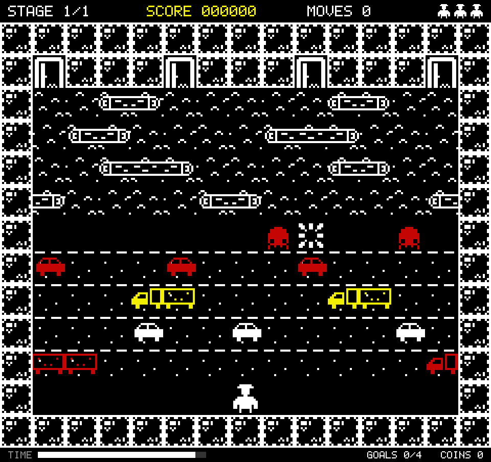
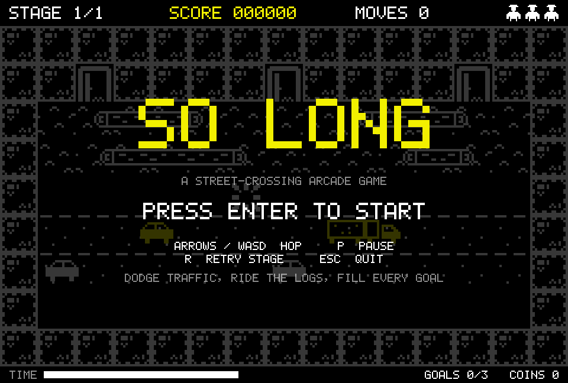
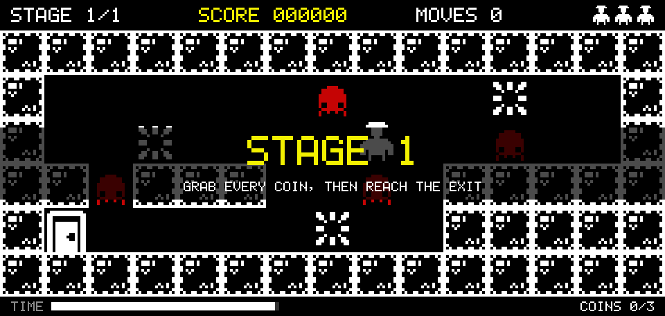
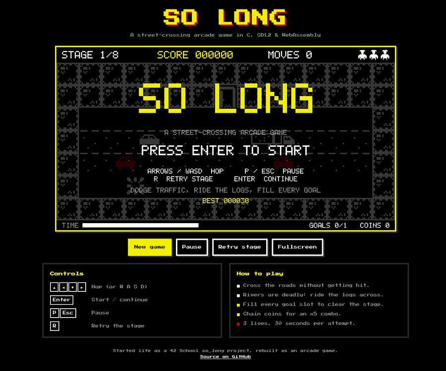

# SO LONG: a street-crossing arcade game 

A street-crossing arcade game written in C with SDL2. It builds both as a native Linux binary and as **WebAssembly** for the browser.

**[▶ Play it in the browser](https://matsadura.github.io/so_long/)** (live once GitHub Pages is enabled; see [Deployment](#deployment))



It began as `so_long`, the 42 School 2D-game project: collect every item, then reach the exit, rendered with MiniLibX. That version had separate mandatory and bonus builds. It has since become a single, leak-free arcade game:

- Lane-based traffic and rivers, inspired by classic street-crossing arcade games.
- A browser build.
- The original 1-bit pixel-art style, kept throughout.

The original 42 submission is commit `128042e` on `main`.

---

## Gameplay

| | |
|---|---|
| **Goal** | Fill every goal slot at the top of the stage. Each one sends you back to the start for another run. |
| **Roads** | Cars and trucks drive at different speeds and directions and wrap around the edges. One touch and it's *SPLAT!* |
| **Rivers** | The water is deadly. Ride the logs, but don't let them carry you into the wall. |
| **Coins** | Optional sparkles. Grab them in quick succession for a combo multiplier, up to x5. |
| **Patrols** | Red invaders pace the safe medians. |
| **Lives & timer** | 3 lives, and 30 seconds per attempt. The time you have left becomes bonus points. |
| **Scoring** | +10 for each new row, 50 × combo for each coin, 200 + time bonus for each goal, +1000 for each stage cleared. Your best score is saved (in localStorage in the browser). |
| **Stages** | 8 stages, from two slow roads up to five rivers, five roads and five goals at full speed. |

The game has a title screen, a stage intro banner, pause, a stage-clear tally, and game-over and victory screens. Starting a new run is one key press away; you never need to restart the program.

The original `so_long` maps still work with their original rules (collect everything, then exit): `./so_long assets/maps/classic/*.ber`.

### Controls

| Key | Action |
|---|---|
| `↑ ↓ ← →` / `W A S D` | Hop |
| `Enter` / `Space` | Start, continue |
| `P` | Pause (`Esc` also pauses in the browser) |
| `R` | Retry the stage (start a new run from the end screens) |
| `M` | Mute / unmute (remembered in the browser) |
| `Esc` | Quit (native) |

The web page adds New game, Pause, Retry, Sound and Fullscreen buttons, and an on-screen D-pad on touch devices. The game pauses itself when the tab loses focus.

<p>
  
  
</p>

---

### Music & sound

Everything you hear is 1-bit chiptune, made only from square waves and noise, to match the 1-bit art. It's all original: written as note data and synthesised by [`tools/gen_audio.py`](tools/gen_audio.py) using only the Python standard library.

| | |
|---|---|
| **Title theme** | *"Sidewalk Lights"*: a gentle 8-bar loop in A minor at 112 BPM |
| **Stage theme** | *"Crosswalk Rush"*: a 16-bar loop in C major at 150 BPM, with lead, bass, arpeggio and noise drums |
| **Jingles** | Stage clear, game over, victory |
| **Effects** | Hop, coin (one step higher for each combo level, x1 to x5), goal slot, *splat*, *splash*, caught, time up, start, pause |

```bash
python3 tools/gen_audio.py    # regenerates assets/sounds/*.wav
```

Playback uses a small mixer built on SDL2's audio callback: 8 effect voices plus 1 looping music voice. It needs no extra library natively or in the browser. If no audio device is available, for example in CI, the game simply runs silently. Browsers keep audio suspended until you interact with the page, so the first key press, click or tap starts it.

## Building

### Native (Linux)

```bash
sudo apt install build-essential libsdl2-dev libsdl2-image-dev
make            # ./so_long, built with -Wall -Wextra -Werror
./so_long                          # play the 8-stage campaign
./so_long assets/maps/level3.ber   # play one map (or several, in order)
./so_long --check my_map.ber       # validate maps without opening a window
```

`make clean`, `make fclean` and `make re` work as usual. `make DEBUG=1` builds with `-g3 -O0`.

### WebAssembly

```bash
git clone https://github.com/emscripten-core/emsdk.git ~/emsdk
~/emsdk/emsdk install 7.0.0 && ~/emsdk/emsdk activate 7.0.0   # version CI uses
source ~/emsdk/emsdk_env.sh

make wasm                              # web/index.html, index.js, index.wasm, index.data
python3 -m http.server 8080 -d web     # open http://localhost:8080
```



The web page is generated from [`web/shell.html`](web/shell.html). The sprites and maps are preloaded into Emscripten's virtual filesystem under the same relative `assets/` paths the native build uses.

### Tests

```bash
make test                      # map validation + scripted gameplay (headless)
VALGRIND=1 ./tests/run_tests.sh
```

[`tests/run_tests.sh`](tests/run_tests.sh) checks every valid and invalid map fixture. It also plays scripted inputs on SDL's dummy video driver, using a fixed timestep so the outcomes are exact:
- crossing a road and riding a log into a goal (to the exact score)
- car and water deaths, retry, pause, timer expiry
- game over and an instant new run
- coin combos
- the same enemy timing at 60 Hz and 240 Hz

CI runs the whole suite under Valgrind.

---

## Deployment

**GitHub Pages:** [`.github/workflows/pages.yml`](.github/workflows/pages.yml) builds with Emscripten and publishes only the game files (`index.{html,js,wasm,data}`). It runs on every push to `main` or `refactor/arcade-wasm`, and can be started by hand from the Actions tab. One-time setup:

1. *Settings → Pages → Build and deployment → Source:* choose **GitHub Actions**, not "Deploy from a branch". Deploying from a branch makes GitHub render this README with Jekyll instead of serving the game.
2. *Settings → Environments → github-pages → Deployment branches and tags:* add `refactor/arcade-wasm` if you deploy from that branch. By default only the default branch may deploy.
3. Push, or run the workflow from the Actions tab. The game is then live at `https://matsadura.github.io/so_long/`.

**Vercel / any static host:** run `make wasm` and deploy the four files `web/index.{html,js,wasm,data}`, for example `npx vercel deploy web --prod`. The host must serve `.wasm` as `application/wasm`; GitHub Pages and Vercel both do.

---

## Map format (`.ber`)

Maps are rectangles of characters surrounded by walls:

| Char | Meaning |
|---|---|
| `1` | Wall |
| `0` | Floor / safe median |
| `P` | Player start (exactly one) |
| `E` | Exit (classic) or goal slot (1–16 on lane maps) |
| `C` | Coin |
| `N` | Patrolling enemy (safe rows only) |
| `R` `X` | Road lane: asphalt, vehicle (a run of `X` is a truck) |
| `W` `L` | River lane: water, log (a run of `L` is a longer log) |
| `2`–`9` | On a lane row's left border: the lane flows right at that speed. On the right border: it flows left. |

```
111111111111111
11E1111E1111E11
2WLLLWWWWLLLWW1
1WWLLLLWWWWLLW2
100000C00000001
3RRXRRRRXXRRRR1
1RXRRRRRXRRRRR4
1000000P0000001
111111111111111
```

A map with no lane rows uses the classic `so_long` rules: one exit, which opens once every coin is collected.

Every map is validated before anything is spawned. The parser never crashes or exits on bad input; it reports exactly what's wrong:
- the shape: rectangular, closed walls, size 3×3 to 64×40
- characters and element counts
- lane contents and speed digits
- every coin and every goal slot reachable from the start

It accepts LF and CRLF line endings, and blank lines at the end of the file.

---

## Architecture

```text
includes/
  game.h       game state, entities, tuning constants
  map.h        .ber format, lanes, parser API
  platform.h   window / input / textures / timing abstraction
  ui.h         renderer, HUD, palette
src/
  main.c       entry point, CLI, tick(), native loop and emscripten_set_main_loop_arg
  core/        pure game logic: hops, lanes, collisions, enemies, scoring, state machine
  map/         reading, validation, lane extraction, flood fill, campaign list
  platform/    SDL2 + SDL2_image implementation of platform.h (video, input, audio mixer)
  ui/          world rendering, HUD, title/banner/end screens, bitmap font, sound director
assets/
  sprites/     64x64 PNGs (16x16 pixel art, 4x scale)
  sounds/      22 kHz mono WAVs: music (8-bit), jingles and effects (16-bit)
  maps/        campaign stages, plus classic/ for the original maps
tools/
  gen_sprites.py   regenerates the lane sprites; --check enforces the palette
  gen_audio.py     synthesises all music and sound effects
web/
  shell.html   responsive page wrapped around the WebAssembly build
tests/         fixtures and the headless test runner
```

- **Platform boundary:** `src/core` and `src/map` never include SDL. Everything goes through `platform.h`: input arrives as abstract actions, and drawing goes to texture handles and rectangles.
- **Delta time:** every speed (traffic, hops, patrols, animations, timers) is driven by the elapsed seconds. Gameplay is the same at 60, 120 or 144 Hz. The tests check this by comparing runs at 60 Hz and 240 Hz.
- **Non-blocking loop:** one `tick()` handles one frame (input, update, render). Natively it runs in a vsync- or frame-capped loop; in the browser `emscripten_set_main_loop_arg` drives it through `requestAnimationFrame`.
- **Rendering:** walls, floor and roads are pre-rendered once per stage into a cached texture. Water, items, lanes and actors are drawn on top of it. No allocations happen per frame.
- **Memory:** every allocation, texture and file descriptor is released on exit, on stage changes and on every error path. Valgrind reports no leaks and no open descriptors, and AddressSanitizer/UBSan stay clean on thousands of fuzzed maps.

### Art

Every sprite follows the original 42 art: a 16×16 grid drawn at 4 px per pixel, with flat 1-bit shapes. It uses one palette of white on black, plus the original enemy red `#C50404` and yellow `#F2F000`. The newer lane sprites are generated by `tools/gen_sprites.py`, and `python3 tools/gen_sprites.py --check` fails if any PNG in `assets/sprites` uses a colour outside that palette.
